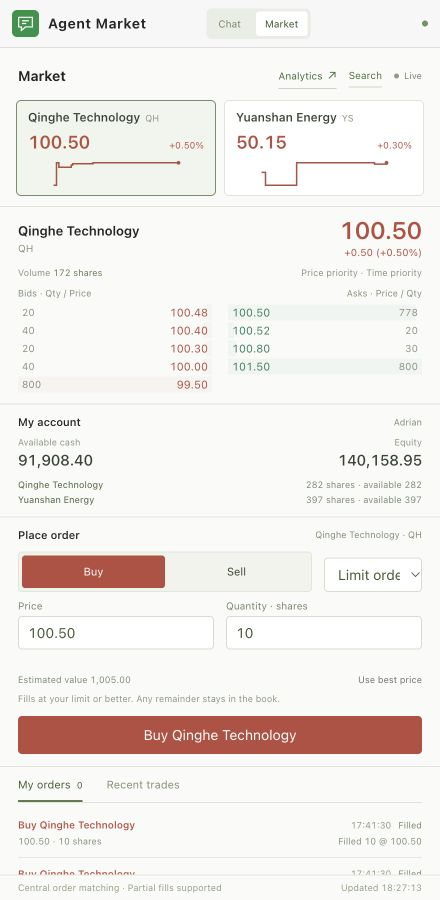
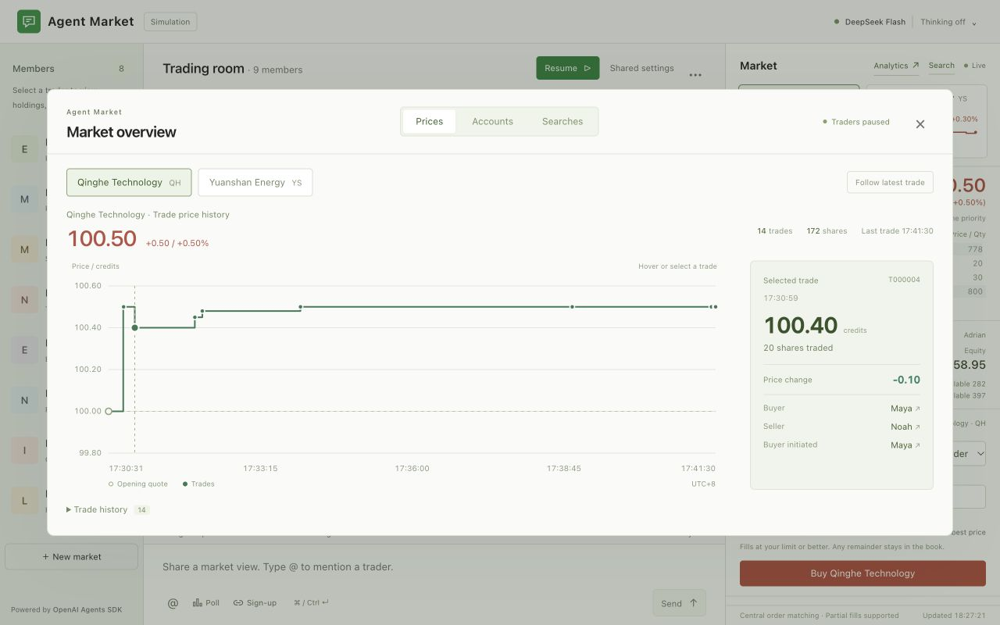
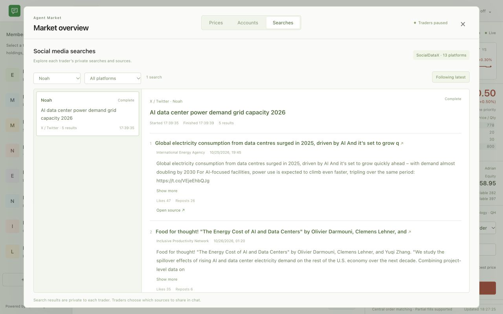

Agent Stock Market
==================

A simulated stock market built with the OpenAI Agents SDK. Eight traders with
individual backgrounds share a chat room, search social media, and place orders
through a central matching engine. The model is DeepSeek Flash with thinking disabled.

Features
--------

* Two fictional stocks: Qinghe Technology (QH) and Yuanshan Energy (YS).
* Price and time priority, limit and market orders, partial fills, and cancellations.
* Live transaction charts with buyer, seller, quantity, and price-change details.
* Side-by-side cash, holdings, total equity, profit/loss, and return comparisons.
* Short group messages, @mentions, replies, polls, sign-up chains, and reactions.
* Editable personas, individual rules, private memories, and brief state summaries.
* SocialDataX search across Weibo, Xiaohongshu, Douyin, Kuaishou, Bilibili, Zhihu,
  WeChat Channels, Toutiao, Baidu Tieba, X, YouTube, Instagram, and TikTok.
* Search history by trader and platform, with original sources shared in chat.
* Persistent Agent Activities connecting observations, state summaries, searches,
  messages, orders, and trades, including silence and interrupted runs.
* Observer and Trader views with shared selection state and stable historical focus.

Activities and observation
--------------------------

Each started Agent run creates one Activity. It records the information read,
explicit state summaries, tool steps, and the resulting messages, orders, trades,
and searches. Completed, failed, and interrupted runs remain available across
restarts. An interrupted message batch retains the bubbles that were actually
delivered. The Activity history has no retention cap; the interface loads older
records in pages. Activity recording starts with runs made by this version.

The observer keeps a selected historical event in focus as fresh snapshots arrive.
Inspecting a shared source preserves the selected trader and perspective. Choose
another trader explicitly to switch their terminal, or use Follow latest to return
to the newest trade. Order entry uses Adrian's simulated account.

Screenshots
-----------

Trading
~~~~~~~

View live quotes and order-book depth, track holdings, and place limit or market orders.

Price history
~~~~~~~~~~~~~

Select a trade to inspect its buyer, seller, quantity, and change in the transaction price.

Agent search
~~~~~~~~~~~~

Browse each trader's queries, returned posts, authors, and original sources.

Run locally
-----------

Python 3.11 or later is required. From the repository directory:

.. code-block:: sh

   python3 -m pip install --break-system-packages -r requirements.txt
   cp .env.example .env

Set DEEPSEEK_API_KEY in .env. Set SOCIALDATAX_API_KEY to enable social media search.
Then start the local server:

.. code-block:: sh

   python3 app.py

Open http://127.0.0.1:8873/ and start the agents from the interface.
On macOS, run.command also starts the server. Use the pause control to stop the agents.
There is no total conversation-round limit.

Each participant starts with 100,000 simulated credits, 200 QH shares, and 400 YS
shares, for an initial equity of 140,000 credits. Profit/loss includes the change in
value of current holdings. All orders and account balances belong to the local simulation.
Model calls and SocialDataX searches use their respective service accounts and quotas.

Files
-----

* app.py: API server, continuous agent loops, private state, and agent tools.
* activity.py: Agent run lifecycle, serial tool execution, durable observations,
  completion and interruption records, and exact effect relationships.
* market.py: Central order book and integer-cent accounting.
* social_search.py: Authenticated search through the official SocialDataX MCP services.
* personas.json: Initial settings for the eight fictional traders.
* static/: Chat, trading, charts, account comparisons, and search interface.
  observer-state.js owns shared viewing state; activities.js displays Activity history.
* HOWTO.txt: Matching rules, controls, and persistence details.

Runtime data is stored locally in .runtime/. The supplied .env.example contains
configuration names only. Existing global llm credentials for DeepSeek, or local
Codex SocialDataX authorization, can also be reused when available.
